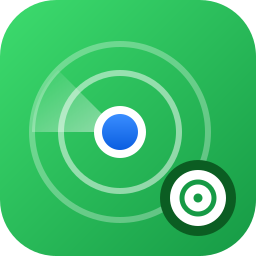

# ha-findmy

[](https://www.home-assistant.io/integrations/marketplace/)
[](https://github.com/juju35/ha-findmy/actions/workflows/hacs.yml)
[](https://github.com/juju35/ha-findmy/actions/workflows/validate.yml)
[](https://github.com/juju35/ha-findmy/actions/workflows/lint.yml)
[](https://github.com/juju35/ha-findmy/releases/latest)
[](https://github.com/juju35/ha-findmy/blob/main/LICENSE)
[](https://buymeacoffee.com/julienstep9)

<p align="center"></p>

<p align="center"></p>

<p align="center">
  <picture>
    <source media="(prefers-color-scheme: dark)" srcset="https://raw.githubusercontent.com/juju35/ha-findmy/main/images/apple-dark.svg">
    
  </picture>
  &nbsp;&nbsp;&nbsp;
  
</p>

Home Assistant integration for Apple's Find My: the position and battery of your **iPhone, iPad, Mac, Apple Watch and AirPods** from iCloud, with **Play sound**, **Display message** and **Lost Mode**, and the position of your **AirTags and other Find My accessories** from the Find My network. Positions and batteries are **kept across restarts** and while Apple has nothing new, and the account asks you to **sign in again** as soon as Apple ends its session.

[](https://my.home-assistant.io/redirect/marketplace_repository/?owner=juju35&repository=ha-findmy&category=integration)

## Features

- **Two sources in one integration**: an **iCloud account** for Apple devices, a **Find My network account** for AirTags and accessories; add as many accounts of each as you need
- **Home Assistant stays responsive**: fetching accessory reports derives their rolling keys and decrypts every report, seconds to minutes of work; it runs on a loop of its own, never on Home Assistant's
- **Fast restarts**: the key chain of each accessory is saved as it goes (a checkpoint), so a restart does not derive every key since the accessory was paired again
- **Never unavailable**: a device keeps its last position, battery and last seen time across restarts and failed fetches; a **Fetch problem** sensor tells when Apple could not be reached
- **Sign in again when needed**: an expired Apple session (about once a week on the Find My network) starts the re-authentication of that account at once, with its verification code; its accessories are kept
- **Verification codes**: trusted devices or text message, chosen in the flow; iCloud then trusts Home Assistant and does not ask again at each restart
- **Import every accessory at once**: a zip of the Find My data exported from a Mac adds all its accessories, with their names and key alignment
- **Accessories as sub-entries**: each accessory is a sub-entry of its account (added or removed on the account's page), with its own device
- **Light on Apple**: one request per account per refresh, 15 minutes by default on the Find My network (never less), a first refresh a few seconds after start-up instead of a burst, and manual refreshes limited
- **Actions** for iCloud devices: `findmy.play_sound`, `findmy.display_message`, `findmy.lost_mode`, plus `findmy.refresh`
- **Ready for [Tracker Card](https://github.com/juju35/ha-tracker-card)**: AirTags and accessories show up on its radar with their last seen time and battery
- **Diagnostics** with the account, keys and positions redacted
- English, French, German, Spanish, Italian, Dutch, Portuguese (European and Brazilian), Polish, Serbian (Cyrillic and Latin), Romanian, Danish, Swedish, Bulgarian, Russian, Ukrainian, Hungarian, Slovak, Czech, Slovenian, Latvian and Greek

## Prerequisites

- Home Assistant 2026.6 or newer
- An Apple Account with two-factor authentication by **verification codes** (accounts that sign in with a security key only are not supported)
- For AirTags and accessories: their keys, exported from a Mac signed in to the same Apple Account (see [Exporting the keys of your accessories](#exporting-the-keys-of-your-accessories))

## Installation

### Via the Marketplace (recommended)

Click the button below to add the repository directly:

[](https://my.home-assistant.io/redirect/marketplace_repository/?owner=juju35&repository=ha-findmy&category=integration)

Then click **Install** and restart Home Assistant.

Or manually:

1. Open **Settings → Marketplace → Add from link** (top right; this needs a GitHub account connected)
2. Add `https://github.com/juju35/ha-findmy` — Type: **Integration**
3. Open **Find My** and click **Install**
4. Restart Home Assistant

### Manual

Copy `custom_components/findmy/` to `/config/custom_components/findmy/`, then restart Home Assistant.

## Configuration

**Settings → Devices & services → Add integration → Find My**, then choose the source.

### iCloud account

| Field | Description |
|---|---|
| Apple Account | E-mail address or phone number of the account |
| Password | Its password |
| Include family devices | Also add the devices of the family members who share their location with you |

A verification code follows the first time. Every device of the account appears with its position, battery, status and actions.

### Find My network account

| Field | Description |
|---|---|
| Apple Account | The account the accessories belong to |
| Password | Its password |
| Anisette server (advanced) | Apple only answers clients that send *anisette* data. It is generated by the integration by default; give the address of your own anisette server to use it instead |

Choose where the verification code is sent (trusted devices or a phone number), enter it, and the account is added. Then open the account (**Settings → Devices & services → Find My**) and click **Add accessories**:

| Choice | What to give |
|---|---|
| Every accessory from an export (.zip) | A zip of the decrypted Find My data: every accessory of its `OwnedBeacons` folder is added, named after `BeaconNamingRecord` and aligned with `KeyAlignmentRecords` |
| One accessory (.plist) | The accessory's decrypted file from `OwnedBeacons`, and optionally its `KeyAlignmentRecords` file |
| One accessory or a list of keys (.json) | An accessory exported as JSON, or a list of private keys of a DIY tag |
| A tag with a static key | The base64 private key of a DIY tag that always broadcasts the same key |

### Exporting the keys of your accessories

The Find My app on a Mac keeps the keys of every accessory of the account, one record per accessory in the `OwnedBeacons` folder of its data. On recent macOS releases this data is in `~/Library/Group Containers/group.com.apple.icloud.searchpartyuseragent/Library/Storage/` (older releases used `~/Library/com.apple.icloud.searchpartyd/`), next to the `BeaconNamingRecord` and `KeyAlignmentRecords` folders.

These `.record` files are **encrypted** with a key that never leaves the Mac's keychain, so Home Assistant cannot read them as they are. On the Mac, first decrypt them into property lists (`.plist`) with a tool that decrypts the Find My data, then zip the decrypted `OwnedBeacons`, `BeaconNamingRecord` and `KeyAlignmentRecords` folders and import the zip. Given a file or a zip that is still encrypted, the integration says so instead of importing nothing. Only the property lists of old macOS releases (13 and earlier) are readable without this step.

The exported files hold the private keys of your accessories: keep them to yourself and delete the copies once imported.

The key alignment (`KeyAlignmentRecords`) is optional but worth it: without it, the first fetch of an accessory paired long ago derives its keys from the pairing date, which takes a while (once only: the integration then saves where it is).

An AirTag reports its position through the Find My network only when it is away from your Apple devices: at home, next to your iPhone, it has nothing new to report.

### Options

| Option | Source | Default | Description |
|---|---|---|---|
| Refresh interval | Find My network | 15 min | 15 to 120 minutes. Accessories upload their position about every 15 minutes: asking more often brings nothing and risks Apple throttling the account |
| Refresh interval | iCloud | 5 min | 2 to 60 minutes |
| Include family devices | iCloud | On | Devices of the family members who share their location |
| Ask the devices to locate themselves | iCloud | On | Each refresh asks the devices for a fresh position, as the Find My app does. Off, the last position they sent on their own is read, which spares their battery |

## Entities

Each device or accessory is a device of its own, named after it. Entity names stay in English in every language, so entity IDs do not depend on the language of Home Assistant.

| Entity | Source | Description |
|---|---|---|
| `device_tracker.<name>` | Both | Position, with `gps_accuracy`, `last_seen`, `source` (`icloud` or `network`), and `altitude` / `position_type` for iCloud devices |
| `sensor.<name>_last_seen` | Both | When the position was recorded |
| `binary_sensor.<name>_battery_low` | Both | On when the battery is low (`low` or `critical` for accessories, 20 % or less for iCloud devices) |
| `sensor.<name>_battery` | iCloud | Battery level (%) |
| `binary_sensor.<name>_charging` | iCloud | On while charging |
| `binary_sensor.<name>_lost_mode` | iCloud | On while Lost Mode is on |
| `sensor.<name>_status` | iCloud | `online`, `offline`, `pending`, `unregistered` (diagnostic) |
| `button.<name>_play_sound` | iCloud | Makes the device ring, even on silent |
| `sensor.<name>_battery_state` | Find My network | `full`, `medium`, `low` or `critical`, as the accessory reports it |
| `sensor.<account>_last_fetch` | Account | Last request to Apple, with `result`, `duration`, `error` and `devices` (diagnostic) |
| `binary_sensor.<account>_fetch_problem` | Account | On while the last request to Apple failed (diagnostic) |
| `button.<account>_refresh` | Account | Asks Apple now (at most every 5 minutes on the Find My network, 30 seconds on iCloud) |

## Actions

| Action | Target | Fields |
|---|---|---|
| `findmy.play_sound` | iCloud device trackers | `subject` (optional) |
| `findmy.display_message` | iCloud device trackers | `message`, `subject` (optional), `sound` (optional) |
| `findmy.lost_mode` | iCloud device trackers | `phone_number`, `message` (optional; Apple's text when empty) |
| `findmy.refresh` | — | `config_entry_id` (optional; every account when empty) |

```yaml
# Ring the phone when the "find my phone" button is pressed
automation:
  - alias: Find my phone
    triggers:
      - trigger: state
        entity_id: input_button.find_my_phone
    actions:
      - action: findmy.play_sound
        target:
          entity_id: device_tracker.jane_s_iphone

# Warn when the keys leave home
  - alias: Keys left home
    triggers:
      - trigger: state
        entity_id: device_tracker.keys
        from: home
    actions:
      - action: notify.mobile_app_jane_s_iphone
        data:
          message: "The keys left home ({{ states('sensor.keys_last_seen') | as_datetime | as_local }})"
```

## Troubleshooting

- **"Wrong Apple Account or password"** with the right password on the Find My network: try again a few minutes later, or with your own anisette server (advanced options); Apple sometimes refuses a freshly generated anisette identity
- **An accessory never gets a position**: it is next to one of your Apple devices (nothing to report), or its keys are not the right ones (export them again); the **Last fetch** sensor shows whether Apple answered
- **The account asks to sign in again**: Apple ended the session; open the notification, enter the password and the new verification code, the accessories are kept
- Enable debug logs with:

```yaml
logger:
  logs:
    custom_components.findmy: debug
```

## License

[MIT](LICENSE)
